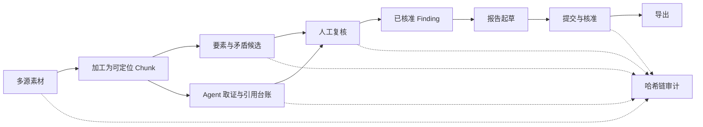
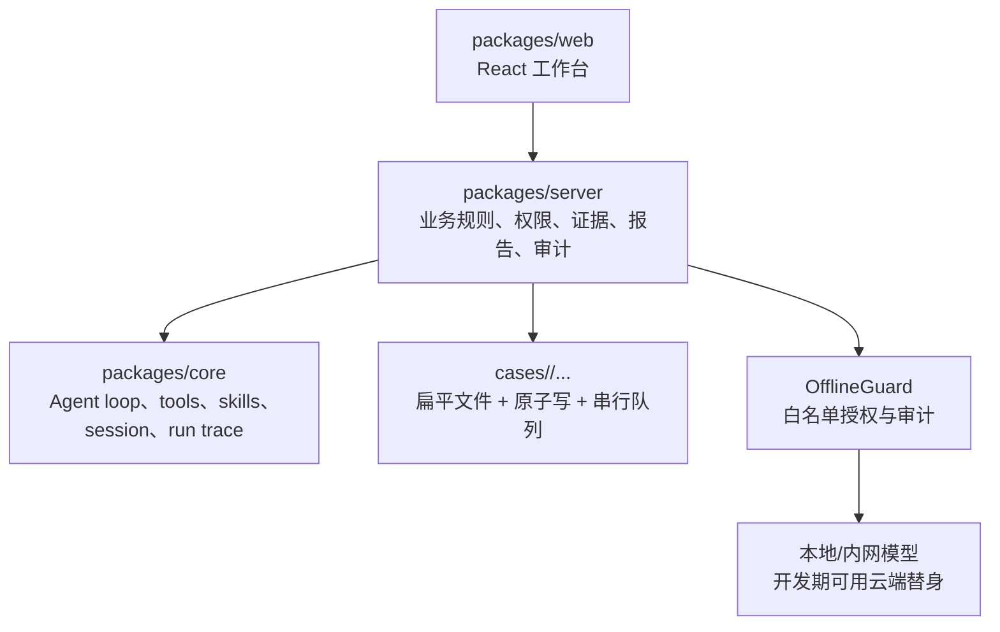

# 架构、权限与评测速览

## 一条业务链

## 三层架构

## 权限矩阵

| 操作 | operator | security | admin |
| --- | ---: | ---: | ---: |
| 查看不高于自身密级的专题 | 是 | 是 | 是 |
| 上传和加工授权专题素材 | 是 | 是 | 是 |
| 发起问答、要素、矛盾分析 | 是 | 是 | 是 |
| 创建/提交 Finding 和报告 | 按专题写权限 | 是 | 是 |
| 核准 Finding 和报告 | 否 | 是 | 是 |
| 查看全局审计 | 否 | 是 | 是 |
| 用户管理 | 否 | 否 | 是 |

角色和密级是两条独立约束：角色决定“能做什么”，密级决定“能看什么”。按钮隐藏只是体验层，服务端仍执行最终校验。

## 当前可复现数字

| 项目 | 结果 | 解释 |
| --- | ---: | --- |
| 自动化回归 | 927 passed / 3 skipped | 3 个跳过均需显式外部模型条件 |
| 测试文件 | 106 passed / 1 skipped | 2026-07-10 `pnpm check` |
| 构建 | 3/3 packages | core/server/web 均通过 |
| 问答错误率 | 30% → 0% | 固定 10 题；目标失败类被消除，仍有两题超时 |
| 检索 R@10 | 0.95 | 清洁合成语料，不能外推真实分布 |
| 历史矛盾 F1 | 0.957 | 2026-07-07 旧算法标注集；新策略待复测 |
| 真实 E2E | 8/8 素材、11 chunks | 103 接地命题，报告 revision 2 导出 |

## 评测口径

- 单元/集成测试验证契约和失败路径，不等同于模型质量。
- Benchmark 必须给出语料、金标、指标和运行日期。
- 真实 E2E 验证链路完整性，不用单个专题的输出数量代替 Precision/Recall/F1。
- 阴性结果必须保留：RAG 增强在清洁语料无净增益；NLI 开思考曾降低召回；简报结构化输出仍可能失败。
